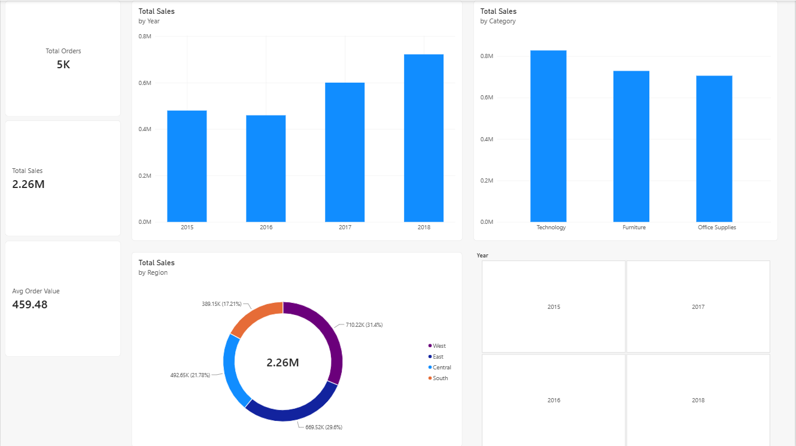

# Superstore Sales Dashboard (Power BI)

An interactive Power BI dashboard that analyzes Superstore sales from 2015 to 2018, covering sales trends, product categories, and regional performance.

## Dataset
- **Source:** [Superstore Sales Dataset](https://www.kaggle.com/) (Kaggle, Rohit Sahoo)
- **Size:** 9,800 rows, 18 columns
- **Period:** January 2015 to December 2018
- **Key fields:** Order Date, Segment, Region, State, Category, Sub-Category, Sales

## Tools Used
- Power BI Desktop
- Power Query (data cleaning)
- DAX (measures and Calendar table)

## What I Did
1. **Cleaned the data in Power Query:** converted the dd/mm/yyyy text dates to real dates using the UK locale, changed Postal Code to text, and removed the Country column (always United States).
2. **Built a data model:** created a Calendar table with DAX and linked it to the sales table with a one-to-many relationship, then marked it as the date table.
3. **Wrote DAX measures:**
   - `Total Sales = SUM(sales[Sales])`
   - `Total Orders = DISTINCTCOUNT(sales[Order ID])`
   - `Avg Order Value = DIVIDE([Total Sales], [Total Orders])`
4. **Designed the dashboard:** KPI cards, sales by year, sales by category, sales by region, and a year slicer.

## Key Insights
- **Total sales were about $2.26M across 4,922 orders**, with an average order value of about $459.
- **Sales grew strongly after 2016.** They dipped about 4% in 2016, then rose about 31% in 2017 and 20% in 2018 (to about $722K).
- **Technology is the top category** (about $827K), followed by Furniture (about $729K) and Office Supplies (about $705K).
- **The West region leads** with about 31% of sales, then East (30%), Central (22%), and South (17%).
- **Phones and Chairs are the top sub-categories**, and California is the top state (about $446K).

## Files
- `superstore_dashboard.pbix`: the Power BI report
- `superstore_sales.csv`: the dataset
- `dashboard.png`: dashboard screenshot

## Author
Sai Krishna | [LinkedIn](https://www.linkedin.com/in/sai-krishna-80253831b)
